  
  

Assuma déploie l'intelligence artificielle d'entreprise en Afrique centrale, et la fait adopter par les équipes.

## Quatre idées guident notre travail

→ **Vendor-neutre.** Nous ne sommes liés à aucun fournisseur : nous vous aidons à choisir le bon, selon votre besoin.

→ **Le socle avant les agents d'IA.** Pas d'agent d'IA utile sans données unifiées et sans gouvernance (qui accède à quoi, qui a fait quoi). Les agents viennent ensuite, et ils agissent dans vos outils.

→ **Resilience-by-design.** Nous concevons nos systèmes pour vos conditions réelles : coupures de courant et réseau lent. Nous utilisons WhatsApp, SMS ou USSD comme interfaces : vos utilisateurs les ont déjà.

→ **Build + adopt.** Nous déployons ET nous faisons adopter. Un projet pilote qui fonctionne mais que personne n'utilise ne vaut rien.

## Notre méthode a quatre étapes

| Étape | Ce que nous faisons |
|---|---|
| On montre nos preuves | Des analyses par secteur, des cas concrets, des guides pratiques pour l'Afrique centrale. |
| On forme vos équipes | Une formation par rôle : dirigeants, managers, opérationnels. Le présentiel en priorité, avec des supports de cours consultables hors ligne. |
| On fixe vos priorités | Un diagnostic et une feuille de route priorisée et chiffrée : les deux ou trois projets qui changent vraiment vos résultats financiers. |
| On livre le système | Nous déployons le système sur les bonnes technologies, jusqu'à ce qu'il fonctionne en production. Il est documenté pour que vos équipes puissent le maintenir. |

## Deux listes, deux questions

Nous gardons deux listes séparées, parce qu'elles répondent à deux questions différentes : quelle plateforme choisir, et avec quoi nous construisons.

→ **Ce que nous vous aidons à choisir** : Google, Anthropic, OpenAI, AWS, Microsoft, Databricks, Palantir. Ce sont des plateformes. Ce choix vous engage pour des années, donc il se discute avant de signer, pas après.

→ **Ce avec quoi nous construisons** : LangGraph, LangChain, Model Context Protocol®, Claude Code, ADK. Ce sont nos outils. Ils ne vous engagent pas : c'est à nous de les maîtriser.

Vous aider à choisir dans la première liste est un service. Maîtriser la seconde est notre métier. Confondre les deux, c'est vendre un fournisseur en croyant vendre du conseil.

## Les secteurs auxquels nous nous adressons

Banques, assurances, télécoms, distribution, secteur public et parapublic, industrie et agro-industrie, entrepôts de matières premières agricoles.

